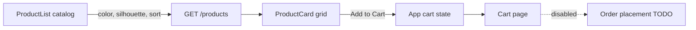

# Caps Order Catalog

Redesign the existing UC1 browse-and-order storefront into a caps catalog modeled on [neweracap.co.uk/collections/trucker-caps](https://www.neweracap.co.uk/collections/trucker-caps). The app already has a working product list, product detail, and in-memory cart; this feature reworks the data model, API, and UI to a caps theme and disables order placement.

## 1. Database schema (review + additive changes)

The current `products` table only has `name, description, price, stock, low_stock_threshold`. A caps catalog needs imagery, brand/team, color, silhouette, and sale pricing. All new columns are **nullable / additive** so UC2/UC3/UC4 remain unaffected.

Add to `products`:

- `image_url` TEXT
- `brand` VARCHAR(100)   — e.g. "New Era", "MLB", "Ducati Motor"
- `team` VARCHAR(100)    — e.g. "New York Yankees" (nullable)
- `color` VARCHAR(50)    — e.g. "Black", "Grey", "Green" (drives Colour filter)
- `silhouette` VARCHAR(50) — e.g. "9FORTY", "9FIFTY" (drives Silhouette filter)
- `sale_price` DECIMAL(10,2) NULL — when set and < price, show as sale

Files to change:

- [database/schema.sql](database/schema.sql): add the columns to the `products` CREATE TABLE and replace the widget seed rows with cap rows.
- [backend/shared/models.py](backend/shared/models.py): add the columns to the `Product` model.
- [backend/shared/schemas.py](backend/shared/schemas.py): add the fields to `ProductBase` (all `Optional`) so `ProductResponse` returns them automatically.
- [backend/shared/migrations.py](backend/shared/migrations.py): replace `seed_products()` widget data with ~12-16 realistic trucker caps (name, brand, team, color, silhouette, price, optional sale_price, image_url, stock).

Migration note: `init_db()` uses `Base.metadata.create_all`, which will NOT alter an existing table. For local SQLite dev the clean path is to run `python -m shared.migrations` (`reset_and_seed()`), which drops and recreates with the new columns + cap seed data. I'll call this out in the summary rather than writing a bespoke ALTER migration.

## 2. Products API — filtering & sorting

Update [backend/api/products.py](backend/api/products.py) `list_products` to accept optional query params and apply them to the query:

- `color`, `silhouette`, `brand` — equality filters (`.filter(Product.color == color)` etc.)
- `sort` — one of `recommended | price_asc | price_desc | newest` mapped to `order_by`
- keep existing `skip` / `limit`

Response already flows through `ProductResponse`, so the new fields ship automatically once added to the schema.

## 3. Frontend — catalog UI (New Era style)

Data flow:

- [frontend/src/api/products.js](frontend/src/api/products.js): pass `color`, `silhouette`, `brand`, `sort` params to `getProducts`.
- [frontend/src/pages/ProductList.jsx](frontend/src/pages/ProductList.jsx): rework into the collection page — collection title/description banner ("TRUCKER CAPS"), a left filter sidebar (Colour swatches, Silhouette checkboxes) + a "Sort by" dropdown, and a responsive product grid. Manage selected filters in state and refetch on change.
- [frontend/src/components/ProductCard.jsx](frontend/src/components/ProductCard.jsx): cap card with product image (`image_url` with graceful fallback), small brand label (e.g. "9FORTY"), product name, price with strikethrough regular price when `sale_price` is set, and an Add to Cart action. Keep out-of-stock handling.
- New small components: `CatalogFilters.jsx` (colour/silhouette) and `SortDropdown.jsx` under `frontend/src/components/`.
- [frontend/src/pages/ProductDetail.jsx](frontend/src/pages/ProductDetail.jsx): swap the emoji block for the real image and show brand / color / silhouette; show regular vs sale price.
- [frontend/src/components/Header.jsx](frontend/src/components/Header.jsx): light rebrand of the "Vibe Strike" wordmark to a caps store name and keep the cart badge.

## 4. Cart — enabled, order placement disabled

- Cart itself already works ([frontend/src/App.jsx](frontend/src/App.jsx) holds `cart` state; add/update/remove implemented). Update the cart image placeholder to use `image_url`.
- [frontend/src/pages/Cart.jsx](frontend/src/pages/Cart.jsx): replace the active "Proceed to Checkout" button with a **disabled** button labeled e.g. "Checkout (coming soon)" plus a short note that order placement is not yet available. Leave the `/checkout` route and `Checkout.jsx` untouched but unreachable from the cart, so the separate order-placement work can re-enable it later.

## Out of scope

- Order placement / checkout submission (explicitly deferred).
- UC2 coupons, UC3 inventory ops, UC4 tracking — untouched (schema changes are backward-compatible).
- Product variants (multiple colours per product) and size selection — the reference has them, but for this feature each cap row is a single SKU; can be a follow-up.

