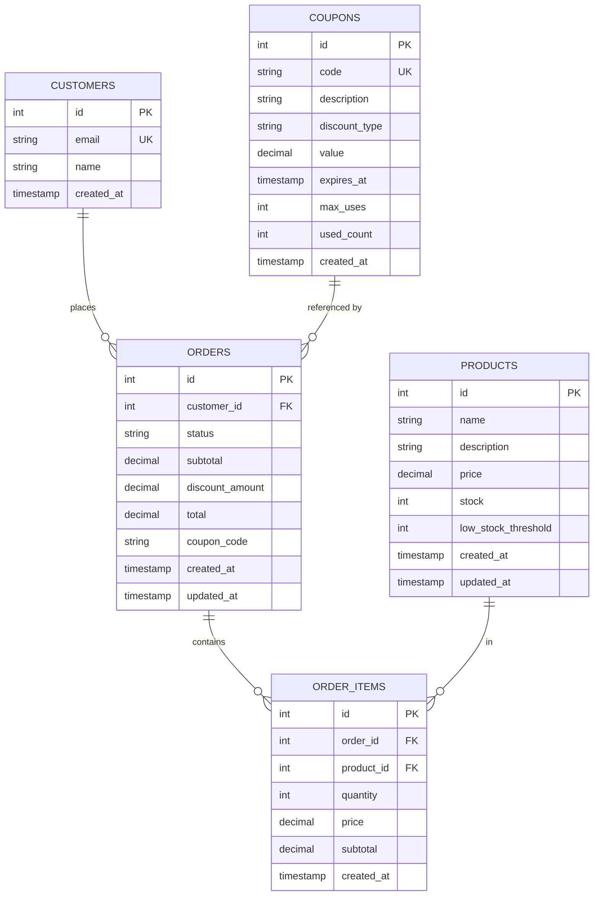

# Vibe Strike Database Schema - Mermaid ER Diagram



## Entity Relationships

| Source | Target | Relationship | Notes |
|--------|--------|--------------|-------|
| **customers** | **orders** | 1:N | Customer places multiple orders. ON DELETE CASCADE |
| **orders** | **order_items** | 1:N | Order contains multiple line items. ON DELETE CASCADE |
| **products** | **order_items** | 1:N | Product appears in many orders. ON DELETE RESTRICT |
| **coupons** | **orders** | Soft FK | Orders reference coupons via `coupon_code` VARCHAR |

## Key Constraints

### Order Status Transitions
```
pending → confirmed → shipped → delivered
   ↓                      ↓
cancelled            (terminal)
```

### Field Validations
- `products.price > 0`
- `products.stock >= 0`
- `orders.subtotal >= 0`
- `orders.total >= 0`
- `order_items.quantity > 0`
- `coupons.value > 0`
- `coupons.discount_type IN ('percent', 'fixed')`

### Unique Constraints
- `customers.email` – UNIQUE
- `coupons.code` – UNIQUE

### Critical Indexes
- `idx_products_stock(id, stock)` – Atomic order placement (FOR UPDATE)
- `idx_products_low_stock(stock, low_stock_threshold)` – Low-stock alerts
- `idx_customers_email(email)` – Customer lookup
- `idx_orders_customer_id(customer_id)` – Order history
- `idx_orders_status(status)` – Ops dashboard queries
- `idx_coupons_code(code)` – Coupon validation

## Isolation & Concurrency

**Transaction Level:** SERIALIZABLE
**Stock Lock Strategy:** FOR UPDATE (exclusive locks prevent race conditions)

Example atomic order placement:
```
T1: SELECT ... FOR UPDATE (lock acquired)
    CHECK stock >= quantity ✓
    UPDATE stock -= quantity
    COMMIT

T2: SELECT ... FOR UPDATE (blocks until T1 commits)
    If stock insufficient → ROLLBACK with OutOfStockError
```

## Use Case Mapping

| UC | Tables | Primary Operations |
|----|--------|-------------------|
| **UC1: Browse & Order** | products, customers, orders, order_items | GET /products, POST /orders (atomic) |
| **UC2: Discounts** | coupons, orders | POST /coupons/validate, apply discount |
| **UC3: Inventory** | products | GET /products/low-stock, PATCH restock |
| **UC4: Tracking** | orders, order_items, products | GET /orders/:id, PATCH /orders/:id/status |
