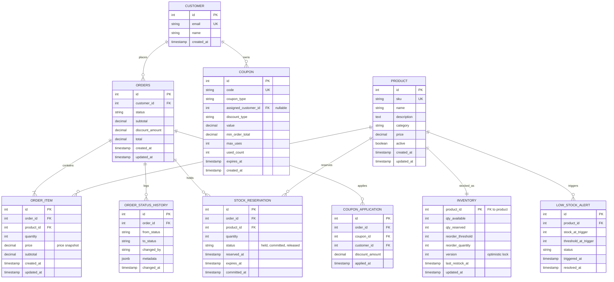

# Database Schema Improvements

## Overview
This document outlines proposed improvements to the Vibe Strike database schema. The improvements are organized by priority and include impact analysis for each change.

---

## 1. **HIGH PRIORITY: Data Integrity & Race Conditions**

### 1.1 Add Optimistic Locking to INVENTORY
**Current Issue:** Inventory is stored in `products.stock` — no versioning for concurrent updates.

**Proposed Change:**
```sql
-- Add version column for optimistic locking
ALTER TABLE products ADD COLUMN IF NOT EXISTS version INTEGER DEFAULT 1;

-- Stock deduction becomes:
-- UPDATE products 
-- SET stock = stock - :qty, version = version + 1 
-- WHERE id = :id AND stock >= :qty AND version = :expected_version
```

**Impact:**
- ✅ Prevents lost updates in concurrent stock modifications
- ✅ Detects if reservation expired between check and commit
- 🔧 Requires backend to track and validate version on retry

---

### 1.2 Formal STOCK_RESERVATION Table
**Current Issue:** No formal reservation tracking; only `coupon_code` string in orders.

**Proposed Change:**
```sql
CREATE TABLE IF NOT EXISTS stock_reservations (
  id SERIAL PRIMARY KEY,
  order_id INTEGER NOT NULL REFERENCES orders(id) ON DELETE CASCADE,
  product_id INTEGER NOT NULL REFERENCES products(id),
  quantity INTEGER NOT NULL,
  status VARCHAR(20) DEFAULT 'held',  -- held, committed, released
  reserved_at TIMESTAMP DEFAULT CURRENT_TIMESTAMP,
  expires_at TIMESTAMP DEFAULT CURRENT_TIMESTAMP + INTERVAL '10 minutes',
  committed_at TIMESTAMP NULL,
  CONSTRAINT check_qty_positive CHECK (quantity > 0),
  CONSTRAINT check_valid_status CHECK (status IN ('held', 'committed', 'released'))
);

CREATE INDEX IF NOT EXISTS idx_reservations_order_id ON stock_reservations(order_id);
CREATE INDEX IF NOT EXISTS idx_reservations_product_id ON stock_reservations(product_id);
CREATE INDEX IF NOT EXISTS idx_reservations_expires_at ON stock_reservations(expires_at);
CREATE INDEX IF NOT EXISTS idx_reservations_status ON stock_reservations(status);
```

**Impact:**
- ✅ Handles cart → pending → confirmed flow (UC1)
- ✅ Expired reservations can be auto-released (background job)
- 🔧 Adds complexity; requires cleanup job for expired holds
- 📊 Enables reservation analytics & timeout monitoring

---

### 1.3 Formal COUPON_APPLICATION Table
**Current Issue:** `coupon_code` is stored as string in orders; no usage tracking per customer.

**Proposed Change:**
```sql
CREATE TABLE IF NOT EXISTS coupon_applications (
  id SERIAL PRIMARY KEY,
  order_id INTEGER NOT NULL REFERENCES orders(id) ON DELETE CASCADE,
  coupon_id INTEGER NOT NULL REFERENCES coupons(id),
  discount_amount DECIMAL(10, 2) NOT NULL,
  applied_at TIMESTAMP DEFAULT CURRENT_TIMESTAMP,
  CONSTRAINT check_discount_nonnegative CHECK (discount_amount >= 0)
);

CREATE INDEX IF NOT EXISTS idx_coupon_apps_order_id ON coupon_applications(order_id);
CREATE INDEX IF NOT EXISTS idx_coupon_apps_coupon_id ON coupon_applications(coupon_id);
```

**Remove from orders table:**
- `coupon_code VARCHAR(50)` → replace with FK to coupons if single coupon per order
- OR keep both for audit trail

**Impact:**
- ✅ Tracks which coupons were applied to which orders
- ✅ Supports multi-coupon scenarios (future-proofing)
- ✅ Single-use coupons now verifiable: `SELECT COUNT(*) FROM coupon_applications WHERE coupon_id = :id`
- 🔧 One more join for order detail queries

---

## 2. **MEDIUM PRIORITY: Audit & Status Tracking**

### 2.1 ORDER_STATUS_HISTORY Table
**Current Issue:** No audit trail of status changes.

**Proposed Change:**
```sql
CREATE TABLE IF NOT EXISTS order_status_history (
  id SERIAL PRIMARY KEY,
  order_id INTEGER NOT NULL REFERENCES orders(id) ON DELETE CASCADE,
  from_status VARCHAR(50),  -- NULL if first record (initial state)
  to_status VARCHAR(50) NOT NULL,
  changed_by VARCHAR(255),  -- 'system' or user/admin email
  changed_at TIMESTAMP DEFAULT CURRENT_TIMESTAMP,
  metadata JSONB NULL  -- Capture why: {reason: 'payment_declined', ...}
);

CREATE INDEX IF NOT EXISTS idx_order_status_history_order_id ON order_status_history(order_id);
CREATE INDEX IF NOT EXISTS idx_order_status_history_changed_at ON order_status_history(changed_at);
```

**Impact:**
- ✅ Complete audit trail (UC4 requirement)
- ✅ Supports ops dashboard filtering & debugging
- 📊 Enables SLA tracking (pending→confirmed latency)

---

### 2.2 LOW_STOCK_ALERT Table
**Current Issue:** No formal alert tracking for inventory team.

**Proposed Change:**
```sql
CREATE TABLE IF NOT EXISTS low_stock_alerts (
  id SERIAL PRIMARY KEY,
  product_id INTEGER NOT NULL REFERENCES products(id),
  triggered_at TIMESTAMP DEFAULT CURRENT_TIMESTAMP,
  stock_at_trigger INTEGER NOT NULL,
  threshold_at_trigger INTEGER NOT NULL,
  status VARCHAR(20) DEFAULT 'open',  -- open, acknowledged, resolved
  resolved_at TIMESTAMP NULL,
  CONSTRAINT check_valid_status CHECK (status IN ('open', 'acknowledged', 'resolved'))
);

CREATE INDEX IF NOT EXISTS idx_low_stock_alerts_product_id ON low_stock_alerts(product_id);
CREATE INDEX IF NOT EXISTS idx_low_stock_alerts_status ON low_stock_alerts(status);
CREATE INDEX IF NOT EXISTS idx_low_stock_alerts_triggered_at ON low_stock_alerts(triggered_at);
```

**Impact:**
- ✅ Inventory team (UC3) can see alert history
- ✅ Prevents duplicate alerts (mark resolved when restock arrives)
- 📊 Enables alert SLA & incident reports

---

## 3. **MEDIUM PRIORITY: Schema Normalization**

### 3.1 Separate INVENTORY Table
**Current Issue:** Stock & inventory management is mixed with product metadata in `products` table.

**Proposed Change:**
```sql
CREATE TABLE IF NOT EXISTS inventory (
  product_id INTEGER PRIMARY KEY REFERENCES products(id) ON DELETE CASCADE,
  qty_available INTEGER NOT NULL DEFAULT 0,
  qty_reserved INTEGER NOT NULL DEFAULT 0,
  reorder_threshold INTEGER DEFAULT 10,
  reorder_quantity INTEGER DEFAULT 50,  -- How much to order when low
  last_restock_at TIMESTAMP NULL,
  version INTEGER DEFAULT 1,  -- For optimistic locking
  updated_at TIMESTAMP DEFAULT CURRENT_TIMESTAMP,
  CONSTRAINT check_available_nonnegative CHECK (qty_available >= 0),
  CONSTRAINT check_reserved_nonnegative CHECK (qty_reserved >= 0)
);

-- Update products table: REMOVE stock, low_stock_threshold
ALTER TABLE products DROP COLUMN IF EXISTS stock CASCADE;
ALTER TABLE products DROP COLUMN IF EXISTS low_stock_threshold CASCADE;
```

**Impact:**
- ✅ Cleaner separation of concerns (product ≠ inventory)
- ✅ Inventory ops (UC3) have their own table/indexes
- ✅ Easier to add warehouse/location-specific inventory later
- 🔧 Requires JOIN for product availability queries
- ⚠️ Breaking change for UC1 & UC3 (update all queries)

---

### 3.2 Coupon Ownership & Usage Limits
**Current Issue:** Coupons have global `max_uses` but no per-customer limit tracking.

**Proposed Change:**
```sql
-- Enhance coupons table
ALTER TABLE coupons ADD COLUMN IF NOT EXISTS coupon_type VARCHAR(20) DEFAULT 'global';
  -- 'global' (any customer), 'first_order' (first order only), 'customer_specific' (assigned to customer)

ALTER TABLE coupons ADD COLUMN IF NOT EXISTS assigned_customer_id INTEGER REFERENCES customers(id) ON DELETE SET NULL;
  -- If coupon_type = 'customer_specific', only this customer can use it

-- Track usage per customer (allows same coupon code for different customers if single-use type)
ALTER TABLE coupon_applications ADD COLUMN IF NOT EXISTS customer_id INTEGER REFERENCES customers(id);

-- Constraint: if coupon.coupon_type = 'first_order', customer must have 0 prior orders
-- (enforced in application layer or trigger)
```

**Impact:**
- ✅ Supports different coupon strategies (global vs. targeted)
- ✅ First-order discount validation
- 🔧 Requires business logic for validation

---

## 4. **LOWER PRIORITY: Scale & Analytics**

### 4.1 Partition ORDERS by date
**Current Issue:** Single `orders` table grows unbounded; old order queries slow down.

**Proposed Change (for 10k+ orders/day):**
```sql
-- For Postgres 10+: Partition by month
ALTER TABLE orders PARTITION BY RANGE (DATE_TRUNC('month', created_at)) (
  PARTITION orders_2026_07 VALUES FROM ('2026-07-01') TO ('2026-08-01'),
  PARTITION orders_2026_08 VALUES FROM ('2026-08-01') TO ('2026-09-01')
  -- Auto-create future partitions via trigger or maintenance job
);
```

**Impact:**
- ✅ Faster queries on recent orders (UC4)
- ✅ Easy archival of old orders
- 🔧 Adds operational complexity (partition management)
- ⏱️ Defer until order volume justifies

---

### 4.2 Add ORDER_METRICS View
**Current Issue:** No easy way to see aggregate stats (revenue, conversion, etc.)

**Proposed Change:**
```sql
CREATE VIEW order_metrics AS
SELECT 
  DATE_TRUNC('day', o.created_at) AS order_date,
  COUNT(*) AS total_orders,
  SUM(o.total) AS total_revenue,
  AVG(o.total) AS avg_order_value,
  COUNT(DISTINCT o.customer_id) AS unique_customers,
  COUNT(CASE WHEN osh.to_status = 'delivered' THEN 1 END) AS delivered_orders
FROM orders o
LEFT JOIN order_status_history osh ON o.id = osh.order_id AND osh.to_status = 'delivered'
GROUP BY 1;
```

**Impact:**
- 📊 Analytics dashboard (ops team)
- ✅ No impact on transactional tables
- ⏱️ Nice-to-have; add after core features work

---

## 5. **QUICK WINS: Small Changes with Big Impact**

### 5.1 Add Timestamps to order_items
```sql
ALTER TABLE order_items ADD COLUMN IF NOT EXISTS updated_at TIMESTAMP DEFAULT CURRENT_TIMESTAMP;
```
**Why:** Tracks if order items were modified (partial cancellations, etc.)

---

### 5.2 Add SKU to products
```sql
ALTER TABLE products ADD COLUMN IF NOT EXISTS sku VARCHAR(50) UNIQUE;
```
**Why:** Real-world products have SKUs; enables external system integration.

---

### 5.3 Add category to products
```sql
ALTER TABLE products ADD COLUMN IF NOT EXISTS category VARCHAR(100);
CREATE INDEX IF NOT EXISTS idx_products_category ON products(category);
```
**Why:** Enables category browsing (UC1 frontend).

---

### 5.4 Constraint: Prevent negative discounts
```sql
ALTER TABLE orders ADD CONSTRAINT check_discount_nonnegative CHECK (discount_amount >= 0);
ALTER TABLE orders ADD CONSTRAINT check_total_positive CHECK (total > 0);
```
**Why:** Data integrity; prevents bad data.

---

## Implementation Priority

| Phase | Tables/Changes | Effort | Impact |
|-------|---|---|---|
| **Phase 1 (Must Have)** | `stock_reservations`, add `version` to products, coupon normalization | 2 hrs | Race conditions fixed; atomic orders |
| **Phase 2 (Should Have)** | `inventory` table, `order_status_history`, `low_stock_alerts` | 3 hrs | Full audit trail; inventory ops enabled |
| **Phase 3 (Nice to Have)** | Metrics view, category/SKU fields, timestamp backfill | 1 hr | Analytics ready |
| **Phase 4 (Future)** | Partition orders, location-aware inventory | TBD | Scale beyond 100k orders/day |

---

## Migration Strategy

### Step 1: Add new tables (non-breaking)
- `stock_reservations`
- `coupon_applications`
- `order_status_history`
- `low_stock_alerts`
- `inventory`

### Step 2: Backfill data
```sql
-- Populate inventory from products
INSERT INTO inventory (product_id, qty_available, reorder_threshold)
SELECT id, stock, low_stock_threshold FROM products;

-- Populate coupon_applications from orders
INSERT INTO coupon_applications (order_id, coupon_id, discount_amount)
SELECT o.id, c.id, o.discount_amount
FROM orders o
JOIN coupons c ON c.code = o.coupon_code
WHERE o.coupon_code IS NOT NULL;

-- Populate order_status_history
INSERT INTO order_status_history (order_id, to_status, changed_at)
SELECT id, status, created_at FROM orders;
```

### Step 3: Update application code
- Point all stock queries to `inventory` table
- Use `coupon_applications` for usage tracking
- Log status changes to `order_status_history` on every update

### Step 4: Deprecate old columns
- Keep `products.stock` for 1 sprint
- Mark `orders.coupon_code` as deprecated in API docs
- Remove after all clients migrated

---

## Validation Checklist

- [ ] All constraints added and tested
- [ ] Indexes created for query performance
- [ ] Backfill scripts tested on staging
- [ ] Application code updated to use new tables
- [ ] No breaking changes to existing API contracts
- [ ] Load test with 10x current data volume
- [ ] Ops team trained on new audit tables

---

## ERD (Improved)



---

## Q&A

**Q: Should we do all of this now or phased?**  
**A:** Phased. Phase 1 (stock_reservations + versioning) is critical for UC1. Phases 2–3 are important for production quality but can ship in Sprint 2.

**Q: Will adding `inventory` table break existing queries?**  
**A:** Yes. Recommend adding it as a new table, backfill, then slowly migrate application code over 1–2 sprints.

**Q: What about the old `products.stock` column?**  
**A:** Keep it during transition period, then drop. Use `BEFORE DELETE` trigger on `inventory` to sync back if needed during cutover.

**Q: Do we need `coupon_applications` if coupons are already in orders?**  
**A:** Only if you need multi-coupon support OR per-customer usage tracking. For UC2 MVP, the current `coupon_code` string + `max_uses` counter may be enough. But **strongly recommend it** for audit trail.

